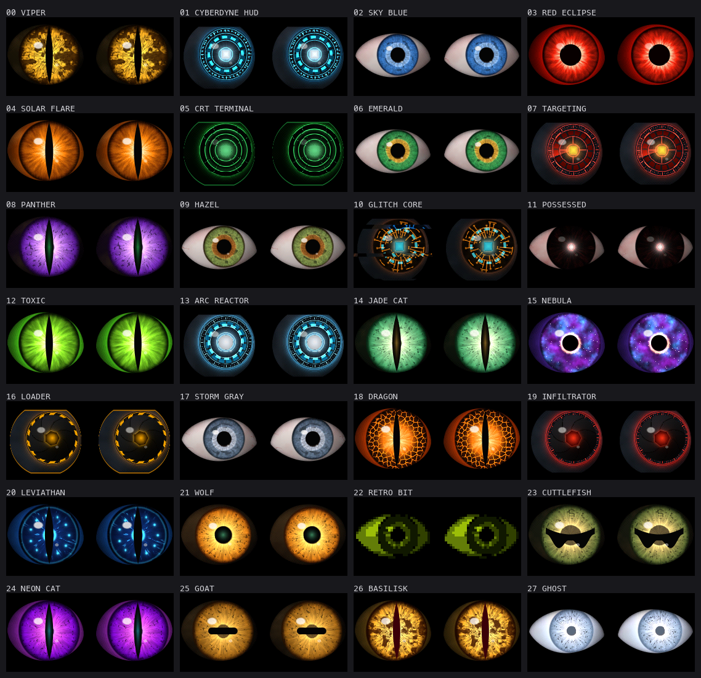

# HaloweenEyesV2

Animated eyes for a Feather M4 Express driving two 1.5" SSD1351 OLEDs, with a
thumb joystick. Same wiring as the original `HaloweenEyes` sketch.



## What changed from v1

- **Real 3D eyes.** Each pixel is traced onto an eyeball: the iris foreshortens
  as the eye turns, the sclera is shaded like a sphere with veins that roll
  with it, lids cast a soft shadow, and the cornea has a moving highlight.
  Every edge is anti-aliased, so small movements look smooth.
- **28 styles** (all 27 originals rebuilt, plus Goat and Ghost). Iris
  textures are generated procedurally when a style loads (fibres, crypts,
  reptile striations, lava cracks, nebulae, circuit traces), so there's no art
  to maintain. Pupils: round, slit, goat bar, cuttlefish W, glowing machine
  core, and a camera aperture whose blades twist as it opens.
- **Lifelike behaviour when nobody is steering.** Saccades with realistic
  timing, micro-saccades, blinks (fast close, slower open, the occasional
  double blink), lids that follow the gaze, pupil hippus and dilation events,
  and a reptile third eyelid. Push the joystick and it takes over; let go and
  the eyes wander again after 1.5 s.
- **Moods**: neutral, angry, suspicious, sleepy. The lids are mirrored per eye,
  so "angry" scowls toward the nose.
- **2–4x the frame rate** (below), with the old "PLEASE STANDBY" idea kept and
  upgraded into a CRT channel change.
- **Sturdier.** Debounced button gestures, joystick calibrated at power-up with
  a round dead zone, a real LiPo charge curve, low-battery handling, and a
  watchdog: if the firmware ever hangs or faults, it logs where and reboots in
  under 2 s instead of freezing.

## Setup

Arduino IDE, board **Adafruit Feather M4 Express (SAMD51)** with the Adafruit
SAMD core. Libraries (the same ones v1 used): Adafruit GFX, Adafruit SSD1351,
Adafruit BusIO. Open `HaloweenEyesV2.ino` and upload.

Everything you'd normally change is in `config.h`: pins, display clock, eye
offsets, joystick direction, brightness steps, which styles are in the
rotation, the boot style and the transition type.

## Controls (joystick button)

| Gesture | Action |
|---|---|
| Click | Next style ("PLEASE STANDBY" channel change) |
| Double click | Next mood: neutral, angry, suspicious, sleepy |
| Triple click | Brightness |
| Hold ~1 s | Sleep (eyes close, screens off). Any press wakes. |
| Click with stick pushed hard left/right | Wink that side's eye |

## Frame rate

Measured on this build (120 MHz CPU, 16.7 MHz display clock). The original
sketch ran at 13.2 fps.

| Style | 120 MHz (default) | 180 MHz |
|---|---|---|
| Human (Sky Blue, Emerald…) | ~45–50 | ~56 |
| Creature (Viper, Dragon…) | ~35–37 | ~41 |
| Busiest machines (Cyberdyne, Targeting) | ~28–30 | ~35–36 |

For the big eyes the display link is the limit. If your wires are short
enough for `SPI_HZ 24000000`, frame rates rise further; on this build 24 MHz
failed (screens kept showing the old frozen image), so 16.7 MHz is the
default. **Tools → CPU Speed → 180 MHz** (an overclock Adafruit offers in the
menu) gives the second column.

The trick that makes this fast: both eyes look the same way, so the eyeball
is shaded once per frame and each eye only adds its own lids. Shading splits
each column into pure-iris and pure-sclera runs, uses packed integer colour
maths, and streams finished frames to the OLEDs by DMA while the next one
renders.

## USB serial console (115200)

`?` help · `n`/`p` next/previous style · a number then Enter jumps to that
style · `l` list styles · `m` mood · `k` blink · `w` wink · `x` startle ·
`s` sleep/wake · `b` brightness · `g` gamma on/off · `f` fps stats ·
`j` joystick readings · `B` benchmark every style · `d` dump a frame

## Troubleshooting

- **Frozen old image, black screens, speckles or garbage:** the display clock
  is too fast for the wiring. Lower `SPI_HZ` in `config.h` (16 → 12 MHz).
- **"Angry" looks sad:** swap `EYE1_NASAL_ON_LEFT` / `EYE2_NASAL_ON_LEFT`.
- **Stick moves the eyes the wrong way:** `JOY_INVERT_X`, `JOY_INVERT_Y`,
  `JOY_SWAP_XY`. Leave the stick centred while powering on (it calibrates).
- **Colours look washed out or too dark:** toggle `g` over serial to compare,
  then set `GAMMA_CORRECT`.
- **After a reboot, serial says "Recovered from a crash/hang":** the watchdog
  caught something. The `pc=` address points at the code involved.
- **Board won't take an upload:** double-tap the Feather's reset button to
  enter the bootloader, then upload again.

## Adding or changing styles

Styles live in `EyeStyles.cpp`. Each one starts from a family preset (human,
creature, machine) and overrides colours, iris pattern, pupil shape, glow,
pulse, overlays and effects. `EyeStyle.h` documents every field.

To see changes without flashing, `extras/preview` builds the same engine on a
Mac and renders PNGs:

```bash
sh extras/preview/build.sh
./extras/preview/preview sheet /tmp/eyes && python3 extras/preview/sheet.py sheet /tmp/eyes /tmp/eyes/sheet.png
```

`extras/serial_tool.py` talks to the board (`log` to send commands and read
output, `dump` to grab the live frame as a PNG).

## Files

| File | Role |
|---|---|
| `HaloweenEyesV2.ino` | App: state machine, frame pipeline, gestures, serial console |
| `config.h` | Settings |
| `EyeRenderer.*` | The eye renderer (portable C++) |
| `EyeStyles.cpp`, `EyeStyle.h` | Style catalogue and fields |
| `IrisBaker.*` | Procedural iris and sclera textures |
| `EyeBehavior.*` | Gaze, blinks, pupil, moods |
| `Screens.*` | Standby card, text, CRT effects |
| `EyeDisplay.*` | SSD1351 driver with DMA transfers |
| `Controls.*`, `Battery.*` | Joystick/button, LiPo monitor |
| `CrashGuard.*` | Fault/hang logging and auto-reboot |
