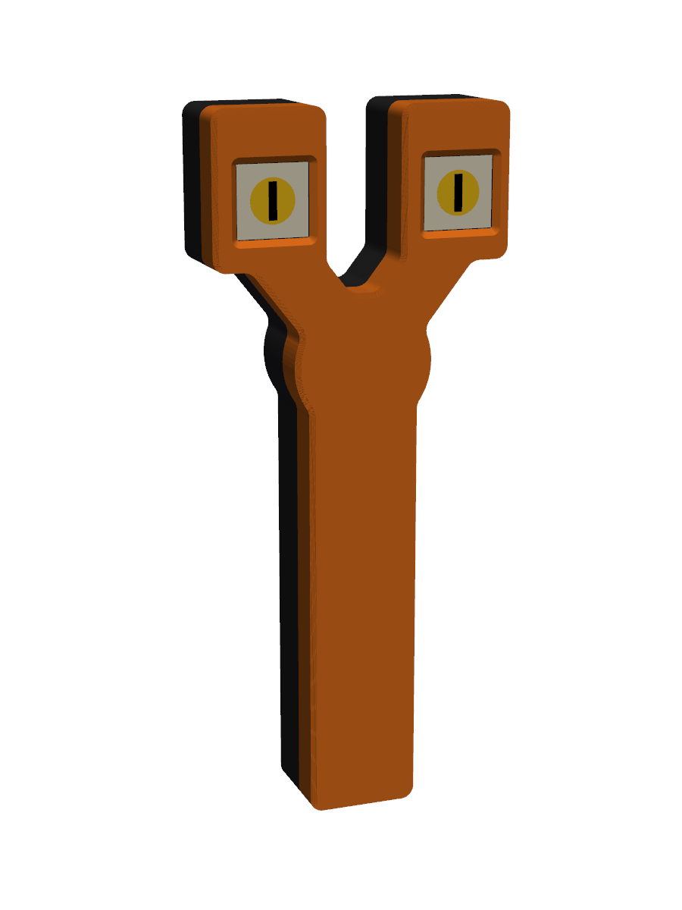
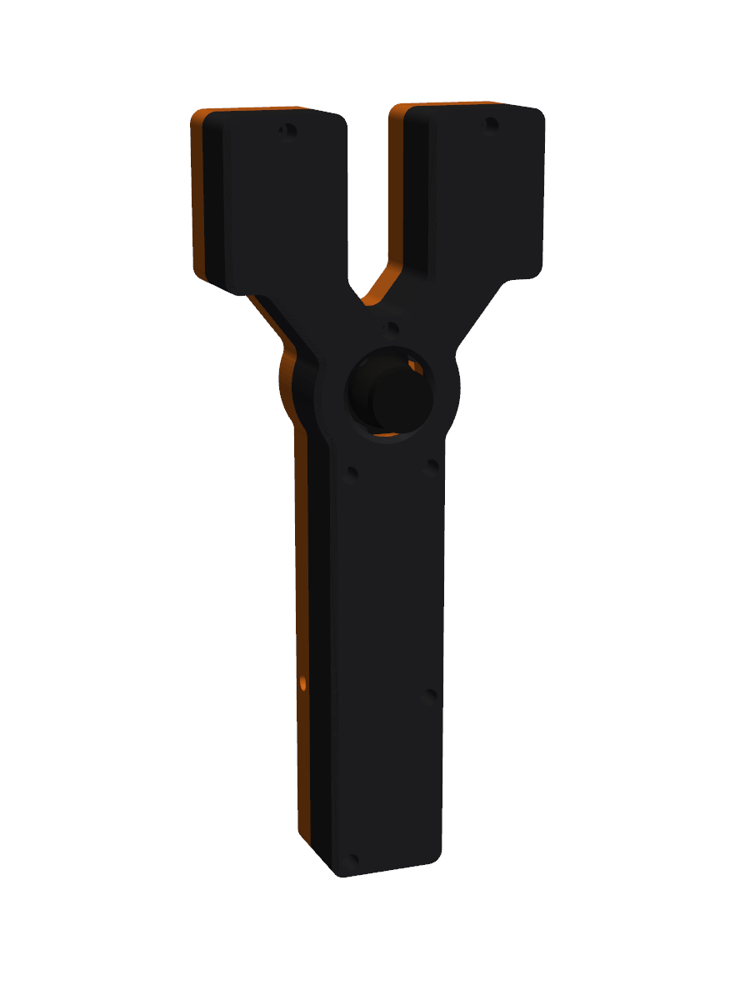
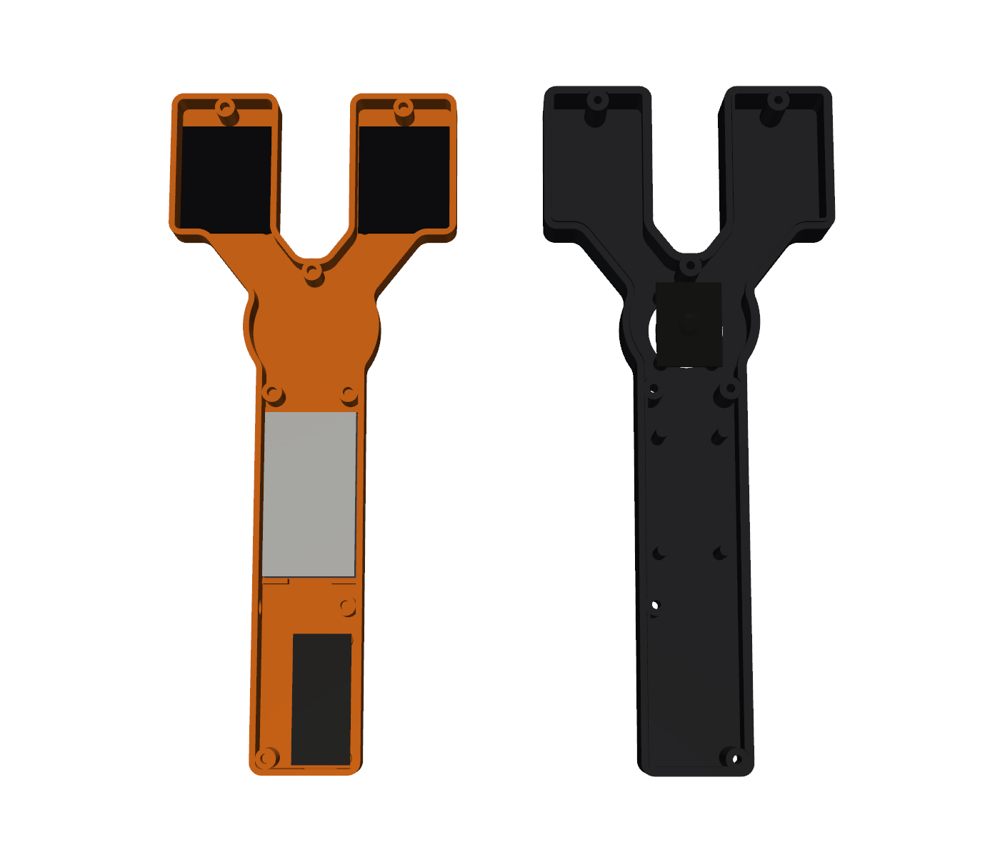

# Slingshot frame for HaloweenEyesV2

A two-piece, Y-shaped clamshell. The OLED eyes sit in the fork tips facing the
audience, the joystick sits in the fork facing you, and the handle holds the
battery and the Feather. The USB port comes out the bottom of the handle.

 


Overall size: 115 × 271 × 41 mm.

## Files (`stl/`)

| File | Print it |
|---|---|
| `fit_test_oled.stl` | **First.** One eye bezel with its M2 bosses (about 20 min). Check the window position and that the glass doesn't bottom out. |
| `fit_test_joystick.stl` | **First.** The hub plate with the joystick standoffs. Check the hole spacing and that the stick moves freely. |
| `eyes_frame_front.stl` | Front half (audience side), already lying face-down. |
| `eyes_frame_back.stl` | Back half (your side), already lying face-down. |

Neither half needs supports. Settings: PLA or PETG, 0.2 mm layers, 4 walls,
15–20 % infill. Both halves fit the Sidewinder X4 Plus bed as they are.

## Hardware

| Qty | Part | Where |
|---|---|---|
| 8 | M2 heat-set insert + M2 × 5 screw | OLED modules (4 each) |
| 4 | M2.5 insert + M2.5 × 6 | Feather |
| 4 | M2.5 insert + M2.5 × 6 | Joystick (M2.5 leaves slack in its ~3 mm holes) |
| 7 | M3 insert + M3 × 20 socket head | Case halves (heads sit in counterbores on the back) |
| 1 | mini toggle switch, M6 bushing | 6.4 mm hole, low on the side of the handle (your left) |

## Assembly

1. Press in the inserts: M2 and M2.5 in the front half, M3 in the front half's
   case pillars, and M2.5 in the tips of the joystick standoffs (back half).
2. Take the brass standoffs off the OLED modules. Screw each module in
   face-down, header holes up and cable exiting down (the orientation in the
   photo, `EYE*_ROTATION 3`).
3. Put the Feather in with the USB end at the butt, facing up, dupont plugs
   pointing at you. The JST battery plug sits on the switch side.
4. Stick the battery flat in its cradle with foam tape, leads at the bottom.
   The four posts on the back half hold it down when you close the case.
5. Mount the switch through the side hole (nut outside), then screw the
   joystick to the back half with its header pointing down the handle.
6. Run the wires behind the battery, drop the back half on (its lip locates
   it), and fit the 7 M3 screws.

If the stick's directions come out rotated, fix it with `JOY_SWAP_XY` /
`JOY_INVERT_*` in `config.h`.

## Numbers to check (all at the top of `eyes_frame.py`)

These came from datasheets and your photo, not from measuring your parts:

- `OLED_GLASS_T` = 2.8: height of the bosses, PCB front to glass front.
  Too low and the glass presses on the bezel; too high leaves a small gap.
- `OLED_WINDOW` = 27.4: square window showing the full 26.86 mm active
  area, with 0.27 mm to spare on each side. Raise it if the fit test clips
  a row of pixels.
- `OLED_WINDOW_DX` = -1.4: moves the window toward the audience's right,
  away from the glass's flex tail. The fit test shows whether it's right.
- `JOY_HOLE_DX/DY` = 20.5 × 26.5: joystick mounting-hole spacing.
- `JOY_HEIGHT` = 13: joystick PCB top to the inside of the back wall.
  Measure from the PCB up to where the domed boot starts.
- `FEATHER_STANDOFF` = 4: room under the Feather for pin tails. Raise it if
  you used stacking headers with long tails.
- `DEPTH` = 41: set by the dupont plugs on the Feather (about 30 mm above the
  board). Soldering those wires directly would let this drop to about 30.
- `INS_M2/M25/M3`: insert hole diameter and depth. Match these to your kit.

Regenerate:

```
pip install manifold3d numpy pyvista matplotlib
python3 eyes_frame.py --preview
```
